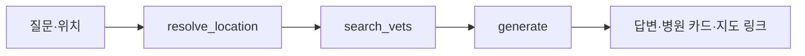
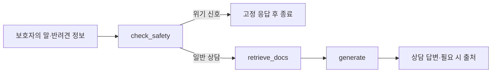

# Pawprint AI 개발 정리

반려견 추모 서비스 Pawprint의 AI 서버다. 동물병원 안내, 펫로스 상담, 사진 자동 태깅을 제공하며 FastAPI로 프론트엔드와 Spring 백엔드에 연결한다.

이 문서는 **2026-10-23 현재 `ai/` 작업 디렉터리의 코드와 Git 이력**을 기준으로 작성했다. 커밋되지 않은 로컬 변경도 포함하며, 운영 배포 여부나 모델 성능을 검증한 보고서는 아니다.

## 1. 구현한 범위

| 기능 | 구현 내용 | 주요 코드 |
| --- | --- | --- |
| 동물병원 안내 | 공공데이터 정규화, 좌표 변환, 거리순 검색, 지도 링크, 답변 생성 | `data/vet_data.py`, `data/geo.py`, `langgraph_rag/nodes.py` |
| 펫로스 상담 | 자료 기반 상담, 반려견 정보 반영, 위기 신호 분기, 선택적 출처 표시 | `data/grief_docs.py`, `langgraph_rag/grief_nodes.py`, `langgraph_rag/safety.py` |
| 챗봇 API | 일반 JSON 응답, SSE 토큰 스트리밍, 메모리 기반 멀티턴 | `api/routers/`, `api/controllers/` |
| 사진 자동 태깅 | Hugging Face 가중치 로드, 이미지 전처리, 8개 클래스 중 분류 | `model/classifier.py` |
| 직접 라벨링 요청 | 업로드 티켓 검증, S3 조회, 사진별 처리, Spring 결과 등록 | `api/routers/dog_labeling_router.py`, `model/` |
| 백그라운드 라벨링 | Spring 작업 선점, 순차 추론, 성공·실패 보고, 폴링 간격 조절 | `worker/photo_labeling_worker.py`, `clients/spring_jobs_client.py` |
| 실행·배포 | uv 의존성 관리, CPU PyTorch, 멀티스테이지 Docker 이미지 | `pyproject.toml`, `uv.lock`, `Dockerfile` |
| 로컬 평가 도구 | 사진별 태그 분포 확인, Gemini 평가와 예측 비교 | `test_model.py`, `eval_frontier.py` — 현재 미추적 파일 |

## 2. 구조와 기술 구성

```text
ai/
├── api/
│   ├── main.py                 # 앱 수명주기, CORS, 공통 예외, 상태 확인
│   ├── routers/                # 병원·상담·사진 API
│   ├── schemas/                # Pydantic 요청·응답
│   └── controllers/            # 그래프 실행 및 SSE 직렬화
├── data/                       # 원본 데이터 정규화, 좌표·거리 계산
├── langgraph_rag/              # 그래프, 상태, 프롬프트, 벡터 검색, CLI
├── model/                      # 사진 분류, S3, 티켓 검증, 직접 결과 등록
├── clients/                    # Spring 작업 선점·결과 보고
├── worker/                     # 사진 라벨링 백그라운드 루프
├── test_model.py               # 로컬 사진 추론 스크립트
├── eval_frontier.py            # 외부 모델과 비교하는 평가 스크립트
├── pyproject.toml / uv.lock
└── Dockerfile
```

Python 요구 버전은 3.11 이상이며 Docker에서는 3.12를 사용한다. API는 FastAPI·Pydantic, 대화 흐름은 LangGraph·LangChain, 벡터 저장소는 로컬 Chroma로 구성했다.

| 용도 | 현재 코드 설정 |
| --- | --- |
| 챗봇 답변 모델 | `gpt-5.6-luna`, 최대 출력 토큰 2,048 (`langgraph_rag/chain.py`) |
| 임베딩 | `nlpai-lab/KURE-v1`, L2 정규화, cosine 검색 |
| 벡터 컬렉션 | `animal_hospitals`, `grief_docs` |
| 사진 모델 | `Dongju-00/pawprint-dog-tagger`의 `dog_model.pt`가 기본값 |
| 추론 구성 | PyTorch·torchvision·timm·Pillow, CUDA 사용 가능 시 CUDA 선택 |
| 외부 연동 | OpenAI, Hugging Face Hub, AWS S3, Spring 내부 HTTP API |

모델명은 현재 소스의 설정값이다. 외부 서비스에서의 사용 가능 여부는 별도로 확인해야 한다. 사진 모델의 실제 아키텍처·클래스 순서·입력 크기는 체크포인트에서 읽는다. 학습 코드와 학습 데이터셋은 이 디렉터리에 포함되어 있지 않다.

## 3. 동물병원 안내



### 데이터와 검색

- `data_raw/animal_hospital.csv`에서 LOCALDATA 동물병원 인허가 데이터를 읽는다. CP949, UTF-8 BOM, UTF-8 순으로 디코딩을 시도한다.
- 상세영업상태명이 `정상`인 행만 적재하고 이름·주소·전화번호·지역 등을 정규화한다.
- 원본 EPSG:5174 좌표를 WGS84 위경도로 변환한다. 거리는 Haversine 공식으로 계산한다.
- 위경도가 있으면 색인의 전체 병원 메타데이터를 가져와 지역 필터와 거리 계산을 적용한다. 반경은 **10km**, 최대 결과는 **5곳**이며 결과가 없어도 반경을 자동 확장하지 않는다.
- `역삼동`처럼 동 이름을 입력하면 색인 데이터로 시도·시군구를 찾고 해당 동 병원들의 평균 좌표를 기준점으로 사용한다. 동명이 중복되면 지역 매핑은 병원이 더 많은 지역을 선택한다.
- 노드에는 좌표가 없을 때의 벡터 검색 경로도 있다. 다만 현재 API의 초기 상태 생성은 누락된 위도·경도를 각각 **강남역 좌표(37.4979, 127.0276)**로 채우므로, 일반 API 요청은 기본적으로 거리 검색 경로를 탄다.

### 답변과 링크

검색한 병원을 문맥으로 전달해 답변을 생성한다. 그래프의 생성 노드는 실행당 LLM 호출을 1회로 제한한다. 네이버 지도 검색 URL은 병원명과 지역으로 코드에서 조립하므로 링크 생성을 위한 외부 API 호출은 없다.

병원은 `vets` 배열로도 내려 프론트가 카드를 구성할 수 있게 했다. 현재 영업시간·전화번호 확인은 지도 링크로 안내하며, CSV의 `정상` 상태가 실시간 진료 가능 여부를 뜻하지는 않는다.

## 4. 펫로스 상담



- 반려견 이름·성별·떠난 날짜를 선택적으로 받는다. 경과 시간은 코드로 계산해 프롬프트에 전달한다.
- 자해·자살 암시는 공백을 제거한 문자열에 정규식을 적용해 감지한다. 감지되면 검색과 LLM 생성을 건너뛰고 코드에 정의된 고정 응답을 반환한다.
- 일반 상담은 `grief_docs`에서 12개 후보를 검색해 관련성 필터를 적용하고 최대 4개 청크를 사용한다. 임계값은 병원 검색과 같은 0.3이며, 모두 미달해도 최고점 1개를 남기는 공통 규칙을 사용한다.
- 프롬프트에는 공감 우선, 짧은 평문 답변, 진단·애도 기간 단정·선택 평가 금지 등의 지침을 넣었다. 이는 생성 지침이며 모든 출력이 준수한다고 검증된 것은 아니다.
- 일반 턴에서는 출처를 숨기고 `(자료 n)` 표기를 후처리로 제거한다. 출처를 묻는 턴은 답변에서 인용한 자료의 원본 메타데이터로 링크를 조립한다.

원본 자료는 `data_raw/grief/*.md`이며 `title`, `source`, `url`, `phase` 메타데이터가 필수다. `phase`는 `acute` 또는 `long`을 허용하고 현재 검색 필터에는 사용하지 않는다. 본문은 소제목·문단 기준으로 목표 600자 단위로 나누고, 마지막 조각이 120자 미만이면 앞 청크와 합친다. 긴 문단은 강제로 자르지 않는다.

## 5. 챗봇 API와 대화 상태

| 메서드 | 경로 | 용도 |
| --- | --- | --- |
| POST | `/api/vets` | 병원 안내 JSON 응답 |
| POST | `/api/vets/stream` | 병원 안내 SSE |
| POST | `/api/grief` | 상담 JSON 응답 |
| POST | `/api/grief/stream` | 상담 SSE |
| POST | `/v1/photo-labeling-requests` | 직접 사진 라벨링 및 Spring 등록 |
| GET | `/health` | 프로세스 응답 및 라벨링·워커 상태 — 로컬 변경에 포함 |

병원 요청 필드는 `question`, 선택 필드 `lat`, `lng`, `region`, `thread_id`다. 상담은 `question`과 선택 필드 `pet_name`, `pet_gender`, `rainbow_date`, `thread_id`를 받는다.

일반 챗봇 성공 응답은 다음 구조다. 병원은 `data.status`가 `ok` 또는 `empty`이고 `vets` 배열이 추가된다. 상담은 `ok` 또는 `crisis`다.

```json
{
  "success": true,
  "data": {
    "status": "ok",
    "thread_id": "생성된 대화 ID",
    "answer": "답변",
    "sources": ""
  },
  "message": "상담 응답에 성공했습니다."
}
```

SSE는 공통 JSON envelope 없이 `data: {JSON}\n\n` 형식으로 보낸다.

| 이벤트 `type` | 병원 | 상담 | 내용 |
| --- | --- | --- | --- |
| `thread` | O | O | 후속 요청에 사용할 `thread_id` |
| `stage` | O | — | 위치 확인·검색 단계. 현재 컨트롤러는 노드 완료 `updates`에서 전송 |
| `token` | O | O | 답변 조각. 상담 위기 응답은 고정 문구를 직접 전송 |
| `done` | O | O | 상태·출처, 병원은 `vets` 포함. 오류 시 `status: error`와 메시지 |

동일한 `thread_id`로 요청하면 `MemorySaver`의 대화 이력을 사용한다. 영구 저장과 이력 조회 API는 없으며 서버 재시작 시 사라진다. 여러 프로세스 사이에서도 이 상태가 공유되지 않는다.

검증 오류는 HTTP 400 `COMMON_400`으로 변환한다. 오류 응답은 `success: false`, `message`, `errorCode`를 반환하고 `data`는 넣지 않는다. 사진 API는 별도 `LABELING_*` 오류 코드를 사용한다. 전체 서비스 규약은 [공통 API 명세](../docs/API_SPEC.md)를 참고한다.

## 6. 사진 자동 태깅

### 모델 추론

기동 시 Hugging Face Hub에서 가중치 경로를 얻어 모델을 한 번 로드한다. 체크포인트는 `arch`, `classes`, `img_size`, `state_dict`를 필수로 가진다. 전처리는 RGB 변환, Resize, CenterCrop, Tensor 변환, ImageNet 평균·표준편차 정규화 순서다. PyTorch CPU 스레드 수는 2로 설정되어 있다.

허용 태그는 `costume`, `playing`, `water`, `with_friends`, `sleeping`, `snow`, `with_owner`, `etc`다. 현재 구현은 **softmax 최고 확률 태그 하나**를 리스트로 반환한다. 최고 확률이 기본 임계값 0.35 미만이거나 허용되지 않은 클래스이면 `etc`를 반환한다. 여러 태그를 동시에 예측하는 구현은 아니다.

### 직접 요청 방식

1. `uploadId`, `uploadTicket`, `petId`, `photos`를 받는다. 사진은 요청당 1~10개이고 `clientFileId`와 `objectKey` 중복을 거부한다.
2. Base64URL payload 문자열의 HMAC-SHA256 서명, 만료, 필수 claim을 검증하고 요청의 업로드·반려견·객체 키가 티켓 범위에 속하는지 확인한다.
3. AWS 기본 자격 증명 체인으로 S3 객체를 읽는다. 최대 10MiB이며 파일 signature로 JPEG·PNG·WebP를 허용한다.
4. 사진별 추론 성공·실패를 분리하고 성공분만 Spring의 `/internal/v1/photo-labeling-results`에 한 번에 등록한다.
5. Spring이 반환한 `photoId`를 매핑해 `succeeded`, `failed` 배열로 응답한다. 일부 또는 전체 사진이 실패해도 등록 통신 오류가 없다면 요청 envelope는 `success: true`일 수 있다.

Spring 등록에는 `X-Internal-Api-Key`, `X-Upload-Ticket`, `Idempotency-Key: uploadId`를 사용한다. 등록 실패는 HTTP 502, 모델 미준비는 유효한 티켓 검증 후 HTTP 503으로 응답한다.

### 백그라운드 방식

```text
Spring 작업 저장 → AI 워커 claim → S3 조회 → 분류 → Spring 결과 보고
```

- `/internal/v1/photo-labeling-jobs/claims`에 `workerId`, `limit`, `leaseSeconds`를 보내 작업을 선점한다. 기본 선점 수는 10, lease는 600초다.
- 각 작업은 `itemId`, `petId`, `objectKey` 존재를 확인하고 순차 처리한다. 블로킹 HTTP·S3·추론은 `asyncio.to_thread`에서 실행한다.
- `/internal/v1/photo-labeling-jobs/{itemId}/result`에 `SUCCEEDED` 또는 `FAILED`를 보고한다. 내부 API 키와 `Idempotency-Key: itemId`를 사용한다.
- 객체 없음·용량 초과·형식 오류는 재시도 불가, S3 읽기·추론 실패는 재시도 가능으로 보고한다. 재시도 가능 여부를 Spring에 전달하며 실제 재배정 정책은 Spring이 담당한다.
- 작업이 없으면 기본 1~5초 범위로 폴링 간격을 늘리고 최대 0.5초 jitter를 더한다. 작업을 받으면 최소 간격으로 되돌린다.
- 모델 미준비 또는 내부 API 키·버킷 누락 시 워커를 시작하지 않는다. 모델 로드 실패는 앱 기동 단계에서 흡수한다.

## 7. 로컬 실행

아래 명령은 모두 `ai/`에서 실행한다.

```bash
uv sync --frozen
cp .env.example .env
```

`.env`에 필요한 값을 설정한다. 현재 `.env.example`에는 전체 연동 설정이 들어 있지 않으므로 아래 표도 함께 확인한다.

| 환경변수 | 용도·기본값 |
| --- | --- |
| `OPENAI_API_KEY` | 챗봇 그래프 구성 시 필수 |
| `CORS_ALLOW_ORIGINS` | 현재 로컬 코드의 허용 Origin 목록, 쉼표 구분. 기본 localhost·127.0.0.1의 8443/5173 포트 |
| `HF_MODEL_REPO`, `HF_MODEL_FILENAME` | 기본 `Dongju-00/pawprint-dog-tagger`, `dog_model.pt`. 명시적으로 빈 값을 넣으면 기본값이 적용되지 않음 |
| `HF_TOKEN` | 모델 저장소 접근에 필요한 경우 설정 |
| `HF_CACHE_DIR`, `HF_HOME` | 다운로드 캐시 경로. Docker의 `HF_HOME`은 `/app/cache/huggingface` |
| `AWS_S3_BUCKET`, `AWS_REGION` | 사진 원본 버킷·리전. 리전 기본 `ap-northeast-2`. 버킷은 직접 API 기본 `pawprint-local`, 워커 기본 빈 문자열이므로 명시 권장 |
| AWS 자격 증명 | boto3 기본 credential chain 사용. 실행 환경의 프로파일·역할·환경변수 등으로 공급 |
| `PHOTO_UPLOAD_TICKET_SECRET` | Spring과 공유하는 직접 요청 티켓 서명 키 |
| `FASTAPI_INTERNAL_API_KEY` | Spring 내부 API 호출 키 |
| `SPRING_INTERNAL_BASE_URL` | 직접 등록 기본 `http://localhost:8080`, 워커 기본 `http://backend:8080`. 로컬 워커 사용 시 명시 필요 |
| `PHOTO_LABELING_WORKER_ENABLED` | 기본 `true`. 챗봇만 실행하려면 `false` |
| `PHOTO_LABELING_WORKER_ID` | 생략 시 호스트명과 프로세스 ID 조합 |
| `PHOTO_LABELING_CLAIM_LIMIT` | 기본 `10` |
| `PHOTO_LABELING_IDLE_MIN_SECONDS`, `PHOTO_LABELING_IDLE_MAX_SECONDS` | 기본 `1`, `5` |
| `GOOGLE_API_KEY` | `eval_frontier.py` 실행에만 필요 |

현재 챗봇 실행 코드에서는 `.env.example`의 네이버 API 키를 사용하지 않는다. 다만 저장소 루트의 Compose는 네이버 키와 `PUBLIC_DATA_API_KEY`를 여전히 필수로 요구하므로 앱 자체 요구사항과 구분해야 한다.

### 원본 준비와 색인

`data_raw/`와 `chroma_db/`는 Git에 포함되지 않는다. 이번 문서화 시점의 로컬 디렉터리에도 두 경로가 없었다. 병원 CSV와 출처가 있는 상담 자료를 별도로 준비한다.

```text
data_raw/
├── animal_hospital.csv
└── grief/
    └── 자료명.md
```

상담 자료 메타데이터 형식은 다음과 같다. URL 자리에는 해당 자료의 실제 원문 URL을 넣는다.

```markdown
---
title: 자료 제목
source: 출처 기관
url: 원문 URL
license: 이용 조건
phase: acute
---

## 소제목
자료 본문
```

```bash
uv run python -m data.vet_data
uv run python -m data.grief_docs
uv run python -m langgraph_rag.rag index
uv run python -m langgraph_rag.rag index-grief
uv run uvicorn api.main:app --reload
```

첫 모델·임베딩 다운로드에는 네트워크가 필요하다. API 문서는 `http://127.0.0.1:8000/docs`에서 확인한다. 워커를 비활성화해도 기동 시 사진 모델 로드는 시도한다.

```bash
curl http://127.0.0.1:8000/health
curl -N http://127.0.0.1:8000/api/vets/stream \
  -H 'Content-Type: application/json' \
  -d '{"question":"근처 동물병원을 알려줘","lat":37.4979,"lng":127.0276}'
curl -N http://127.0.0.1:8000/api/grief/stream \
  -H 'Content-Type: application/json' \
  -d '{"question":"아이가 많이 보고 싶어요","pet_name":"초코"}'
```

CLI도 제공한다: `uv run python -m langgraph_rag.rag`는 병원 대화, 뒤에 `grief`를 붙이면 상담 대화다.

### 사진 확인·평가

`test_photos/`에 로컬 이미지를 두고 다음 스크립트를 실행할 수 있다.

```bash
uv run python test_model.py
uv run python eval_frontier.py
```

첫 스크립트는 사진별 예측과 태그 분포·`etc` 비율을 출력한다. 두 번째는 코드에 설정된 `gemini-3.6-flash`에 로컬 사진을 전송해 대표 태그·부차 태그를 받고, 자체 모델과의 완전 일치·부차 태그 포함 일치·혼동 패턴을 출력한다. 실패한 사진은 비교 집계에서 제외된다.

이는 수동 확인과 외부 모델 비교 도구이며 자동 회귀 테스트가 아니다. 외부 평가와의 일치율은 사람이 확정한 정답에 대한 정확도와 다르다. 이번 문서화에서는 모델 추론·외부 API 호출을 실행하지 않았으며, 확인된 정확도·F1·지연 시간 수치는 없다.

## 8. 배포와 운영 시 확인할 점

Docker는 uv 빌더에서 의존성을 설치하고 Python 3.12 런타임으로 복사하는 멀티스테이지 구성이다. CPU PyTorch 인덱스를 사용하고 비루트 사용자로 Uvicorn을 실행한다. `COPY . .`와 `.dockerignore`로 소스를 포함해 `worker/`, `clients/` 누락으로 발생했던 컨테이너 재시작 문제를 수정했다.

원본 데이터와 색인은 이미지에 넣지 않는다. 운영에서는 `/app/chroma_db`의 `ai-chroma` 볼륨에 색인을, `/app/cache`의 `ai-cache` 볼륨에 다운로드 캐시를 유지한다. CI/CD는 AI 이미지를 빌드해 ECR에 올리는 구성을 갖고 있다. 실제 배포 절차는 [배포 문서](../docs/DEPLOYMENT.md), 구성은 [Compose](../docker-compose.yml), [운영 오버라이드](../docker-compose.prod.yml), [워크플로](../.github/workflows/deploy-backend.yml)를 참고한다.

현재 코드에서 후속 점검이 필요한 부분은 다음과 같다.

- **CORS 설정명 불일치:** 로컬 `api/main.py`는 `CORS_ALLOW_ORIGINS`, 기존 Compose와 배포 문서는 `CORS_ALLOWED_ORIGINS`를 사용한다. 현재 코드로 배포할 때 값을 맞춰야 한다.
- **상태 확인 범위:** `/health`의 `status: ok`는 OpenAI 키·호출 성공·색인 존재를 검사하지 않는다. 그래프와 임베딩은 첫 사용 시 초기화되므로 상태 응답만으로 챗봇 준비를 판단할 수 없다.
- **색인 갱신:** 동일 ID 재적재는 덮어쓰지만 삭제된 병원·줄어든 문서 청크는 자동 제거되지 않는다. 전체 병원 목록·동 매핑은 프로세스 메모리에도 캐시되므로 재색인 후 반영 방법을 고려해야 한다.
- **위치·입력 처리:** 동명이 같은 지역의 모호성, 알 수 없는 동 이름, 잘못된 좌표·기일에 대한 검증을 보강할 여지가 있다. 현재 위도·경도를 하나만 보내면 다른 축은 기본값으로 채워진다.
- **상담 검색·감지:** 자료 관련성이 모두 낮아도 1개를 남기며, 위기 감지는 문맥을 보지 않는 정규식이다. 별도 자료 평가와 오탐·누락 검증이 필요하다.
- **워커 보고 실패:** 결과 보고 중 예외가 발생하고 실패 보고까지 실패하면 작업 루프가 종료될 수 있다. `workerRunning`은 태스크 생존 여부이며 최근 보고 성공이나 진행률은 측정하지 않는다.
- **평가·테스트 근거:** 일부 코드 주석은 `tests/test_safety.py`를 참조하지만 현재 추적 파일에는 해당 테스트가 없고 `tests/`는 ignore 대상이다. 주석만으로 회귀 테스트 통과나 품질을 주장할 수 없다.

## 9. Git 이력과 현재 로컬 작업

아래는 `git log -- .`에서 확인한 주요 변경이다. 커밋은 구현 이력의 근거이며 배포 완료의 근거는 아니다.

| 커밋 | 작업 |
| --- | --- |
| `1f03f27` | 근처 동물병원 Q&A와 API 명세 도입 |
| `f36ab17` | 지도 검색 링크, 토큰 스트리밍, 중복 메시지 처리 개선 |
| `6bcd024` ~ `d788648` | 티켓 검증, S3 조회, 사진 분류, Spring 등록, 직접 라벨링 API |
| `d3ab10e` | 펫로스 상담 모드 추가 |
| `453211e`, `c4fdef4` | Hugging Face Hub 가중치 로딩 적용 |
| `e9086ba` | FastAPI 이미지의 CD 파이프라인 편입 |
| `b7fae08`, `5a06e83` | Spring 작업 클라이언트와 백그라운드 워커 추가 |
| `afa5269` | Docker 이미지의 `worker/`, `clients/` 누락 수정 |
| `370909e` | PyTorch 스레드 수 1 → 2 변경 |

문서 작성 시작 시 커밋되지 않은 변경은 다음과 같았다. 이 문서 작업에서는 해당 코드·의존성·사진을 수정하지 않았다.

- `api/main.py`: 수명주기 정리, 워커 비활성화 로그, `/health`, CORS 설정명·기본 Origin 변경.
- `model/classifier.py`: 별도 로컬 가중치 우선 탐색을 제거하고 `hf_hub_download` 경로 사용, 빈 토큰·캐시 값 처리.
- `worker/photo_labeling_worker.py`: `is_running()` 추가.
- `pyproject.toml`, `uv.lock`: `google-genai` 의존성 추가.
- 미추적 `test_model.py`, `eval_frontier.py`, `test_photos/`: 로컬 추론·비교 평가 작업.

## 10. 문서화 시 확인한 범위

라우터·스키마·그래프·추론·워커 코드, Git 변경 이력과 로컬 diff, Docker·Compose·배포 문서를 정적으로 대조했다. 문서의 상대 링크와 코드에 기재된 주요 상수·경로를 확인했다. 원본 데이터 준비, 색인 생성, 서버 기동, S3·Spring 연동, 모델 성능 평가와 실제 운영 상태 확인은 이번 문서화 범위에서 실행하지 않았다.
